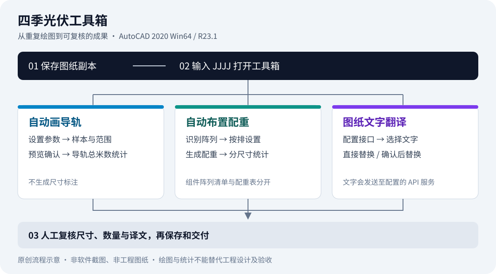

# 四季光伏工具箱

**在 AutoCAD 中完成光伏组件导轨绘制、配重布置与数量统计，并按需翻译图纸文字。**

四季光伏工具箱（FourJ PV Toolbox）面向光伏结构绘图人员，将重复的绘图与统计操作集中到一个工具面板。安装后在 AutoCAD 命令行输入 `JJJJ`，从首页选择功能。

[下载正式安装包](https://github.com/deepfry666/fourj-pv-toolbox/releases/latest) · [快速开始](docs/current/快速开始.md) · [开发文档](docs/current/README.md) · [版本记录](CHANGELOG.md)

> 当前正式版：**v1.0.11**（程序集 `1.0.11.0`）。既有核心运行验证范围为 **AutoCAD 2020 Win64 / R23.1**，不等于完整 GUI、探索者交互或所有安装升级场景已验收；后续验证见 [问题清单](ISSUES.md)。



*上图为原创工作流程示意，不是软件截图或工程图纸，不表示界面布局、实际几何或工程设计参数。*

## 可以做什么

| 工作 | 提供的能力 | 使用前需要知道 |
|---|---|---|
| 自动画导轨 | 设置导轨数量、间距、端伸、图层和颜色；选择组件样本与范围，预览后确认生成 | 读取样本图层中的矩形轻量多段线；导轨垂直组件长边，不生成尺寸标注 |
| 自动布置配重 | 识别完整组件阵列，按排数设置参数，对特殊阵列单独覆盖后生成配重 | 支持的输入与导轨不同，包含顶层二维多段线和块参照；修改组件后需重新识别 |
| 图纸统计 | 框选统计导轨总米数、按尺寸统计配重，并可插入组件阵列清单 | 导轨表、配重表和组件阵列清单用途不同；统计结果需人工核对 |
| 图纸文字翻译 | 直接替换或确认后替换，提供模型选择、术语表、缓存、批量进度与取消 | 需自行配置兼容的翻译 API；文字会发送到所配置服务，首次建议使用确认后替换 |
| 检查软件更新 | 从 GitHub Release 检查和下载完整安装包，校验大小与 SHA-256 | 不热替换已加载的 DLL，也不静默安装；保存图纸、退出 CAD 后再安装 |

### 当前不包含的功能

- **导轨尺寸标注已退出 v1.0.8**：不再提供 `STPVRAILDIM`、`STPVRAILANNOTATE` 或 `GDBZ`。既有尺寸不会被画轨流程清理或修改，需要标注时使用 AutoCAD 原生命令。
- 自动排布已取消开发；自动画支架／混凝土屋面支架大样不进入正式安装包。仓库中的历史或独立模块不代表当前正式功能。
- 不承诺其他 AutoCAD 版本、AutoCAD LT、macOS 或其他 CAD 平台兼容。

## 安装与首次使用

1. 从 [GitHub Releases](https://github.com/deepfry666/fourj-pv-toolbox/releases/latest) 下载安装器及同版 `sha256.txt`。v1.0.11 的安装器资产名为 `FourJ_PV_Toolbox_Setup_v1.0.11.exe`，不要把 Source code 压缩包当作安装包。
2. 核对 SHA-256，保存并备份图纸，完全退出 AutoCAD、探索者和 AutoCAD Core Console。
3. 运行安装器，确认目标为 AutoCAD 2020 R23.1；升级时选择与旧版相同的安装范围，不绕过兼容性或降级检查。
4. 重新启动 AutoCAD，输入 `JJJJ` 打开首页，输入 `STABOUT` 查看版本。先在图纸副本上试用，再人工复核结果。

**安装器与 DLL 尚未进行 Windows Authenticode 代码签名**，可能显示“未知发布者”。请确认下载来源；SHA-256 用于完整性核对，不能替代发布者身份签名。校验命令、操作步骤和常见问题见 [快速开始](docs/current/快速开始.md)。

## 安全与工程边界

- 本工具辅助绘图与统计，不能替代结构计算、荷载与配重设计、规范审查或工程人员验收。参数和生成结果应由使用者按项目要求复核。
- 保留原始图纸，先在副本上操作；检查识别范围、漏项、尺寸、单位和统计口径后再交付。
- 翻译前确认所选文字允许发送给配置的 API 服务商，留意其数据政策和费用。不要在公开 Issue 中上传客户图纸、API 密钥、私人配置或未脱敏日志。

## 开发与源码

仓库同时管理公开源码、安装包发行记录和自动更新。自有代码采用 [MIT](LICENSE)，第三方许可见 [THIRD_PARTY_NOTICES.md](THIRD_PARTY_NOTICES.md)。工程图纸、私人配置、历史二进制和私有开发历史不随源码公开。

```powershell
git clone https://github.com/deepfry666/fourj-pv-toolbox.git FourJ-PV-Toolbox
cd FourJ-PV-Toolbox
powershell -NoProfile -ExecutionPolicy Bypass -File scripts/build.ps1 -AutoCADDir "D:\cad\AutoCAD 2020"
powershell -NoProfile -ExecutionPolicy Bypass -File scripts/test.ps1
```

正式构建需要 Windows、真实 AutoCAD 2020 Win64 R23.1 和 .NET Framework；安装器还需要 Inno Setup。以上不是 Linux 的完整构建承诺。测试使用代码生成的空白毫米图与样例几何，不依赖第三方参考图纸或固定详图库。生成产物放在忽略的本地目录，安装包通过 Releases 分发，不提交到 Git。

| 想了解什么 | 从这里开始 |
|---|---|
| 安装、命令、绘图和翻译流程 | [快速开始](docs/current/快速开始.md) |
| 当前模块、开发工作流与验证边界 | [当前开发入口](docs/current/README.md) · [脚本入口](scripts/README.md) |
| 公开范围、构建限制与开发机迁移 | [OPEN_SOURCE.md](OPEN_SOURCE.md) |
| 已知问题与版本变化 | [问题清单](ISSUES.md) · [CHANGELOG](CHANGELOG.md) |
| 查阅旧版行为与验收记录 | [历史使用说明](docs/历史使用说明.md)，仅用于追溯，不作为当前安装路径 |

本次介绍整理未重新构建或发布安装包。旧 Release、标签及更新入口保持原样；旧标签不标识导入的公开源码快照，基线见 [SOURCE_SNAPSHOT.json](SOURCE_SNAPSHOT.json)。不要据此声称旧安装包可由当前公开源码复现；后续发行须使用新版本号并完成 CAD、安装及升级验证。
